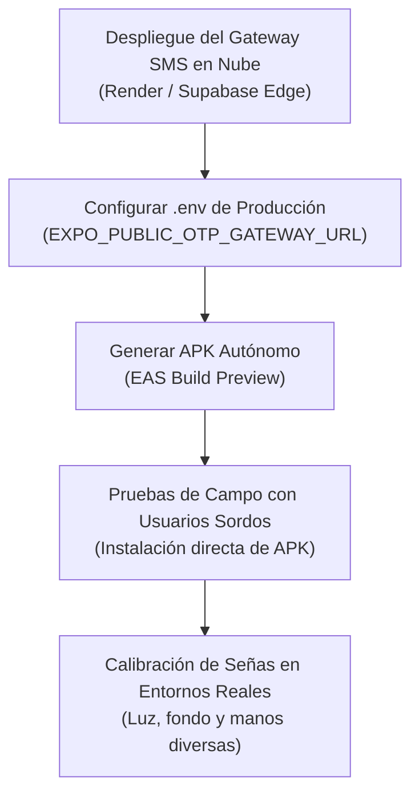

# 📋 Estado Actual del Proyecto LESCOnect y Hoja de Ruta de Pendientes

**Fecha de Actualización:** 3 de Noviembre, 2026  
**Rama Git Activa:** `traductor-v2`  
**Estado de TypeScript:** `npx.cmd tsc -p tsconfig.json --noEmit` ➔ **0 errores**  
**Procesos Activos:** Ninguno (todos los procesos de fondo y subagentes fueron detenidos de forma segura).

---

## 🚀 1. Resumen Ejecutivo de Avances Completados

### A. Autenticación Telefónica SMS / OTP (Arquitectura Zero-Trust)
* **Eliminación de Códigos Locales Ficticios:** Se eliminó por completo `generateSixDigitCode()` del frontend en `src/modules/Auth/services/otpService.ts`. La aplicación móvil ya no inventa códigos ni genera discrepancias con el mensaje.
* **Servidor como Única Fuente de Verdad:** Al solicitar OTP, la app únicamente envía `{ phone }`. El servidor (`server.js` / Supabase) genera criptográficamente el código de 6 dígitos, guarda el hash SHA-256 con sal y TTL de 5 minutos, y lo despacha por SMS GSM a través de la pasarela física.
* **Modal Accesible para Personas Sordas (`SmsOtpVerificationModal.tsx`):**
  * Autocompletado exacto del código que llega por SMS sin comerse dígitos como el `0`.
  * Botón interactivo **"Confirmar código"** que se transforma en un **indicador visual de carga (spinner `<ActivityIndicator />`)** durante la validación contra el servidor.
  * Manejo estricto de intentos fallidos (límite de 5 intentos con bloqueo de seguridad contra ataques de fuerza bruta).
  * Validado en vivo: Despacho y verificación exitosa de SMS real al número `+50684262854`.

### B. Módulo de Emergencias y Despacho SOS Satelital
* **Corrección del Falso Positivo de Servidor:** En `emergencyLocationService.ts`, se corrigió el fallo donde `serverDispatched = true` se marcaba tras un timeout. Ahora solo marca despacho si el servidor retorna status 200/202 confirmado.
* **Fallback Inmediato de Mensajería SMS:** Si no hay servidor o falla la conexión de datos, la app abre directamente la aplicación de mensajería SMS nativa con las coordenadas GPS satelitales y enlace a Google Maps prellenados.
* **Contactos SOS Individuales:** En `SosContactsScreen.tsx`, el botón de mensaje `💬` de cada contacto despacha vía API o abre la mensajería nativa de forma instantánea.

### C. Traductor LESCO (Visión por Computadora y UI Fluida)
* **Eliminación del Parpadeo Brusco:** Se sustituyó la alternancia rápida de estados de `isScanning` por una animación continua de "pulso respiratorio" suave (`breathingAnim` con `useNativeDriver: true`) y textos informativos estables en `SignsToTextScreen.tsx`.
* **Espejado Horizontal para Cámara Frontal (`1 - x`):** Se implementó la inversión horizontal de coordenadas X en landmarks y trayectorias al usar la cámara delantera, corrigiendo la detección querológica estática y el cálculo DTW de señas dinámicas (`Z`, `J`, `Ñ`, `HOLA`, etc.).
* **Escritura y Detección Responsiva:** Búfer de palabras con debouncer calibrado a 1000 ms y feedback háptico sutil (`haptics.light()`).
* **Abecedario LESCO de 30 Letras y Diccionario CENAREC:** Servicios modulares integrados en `lescoAlphabetTrainerService.ts` y `cenarecDictionaryService.ts`.
* **Avatar 3D LESCO ("El Señor y la Señorita"):** Componente interactivo `LescoAvatar3DInterpreter.tsx` con soporte cinemático para interpretación de texto a señas y fallback a los 54 videos oficiales en Cloudflare R2.

### D. Estandarización de Navegación por Pantallas (Defensive Navigation)
* Se auditó y corrigió el flujo de retorno en todas las pantallas secundarias y modales (`HelpScreen.tsx`, `HistoryScreen.tsx`, `EmergenciesScreen.tsx`, `QuickMessagesScreen.tsx`, `ProfileScreen.tsx`, `SosContactsScreen.tsx`, etc.).
* Ahora todas utilizan el patrón seguro:
  ```ts
  if (onBackPress) {
    onBackPress();
  } else if (router.canGoBack()) {
    router.back();
  } else {
    router.replace('/(tabs)');
  }
  ```
  Evitando que el usuario regrese inesperadamente a la pestaña principal (Home) al navegar por submenús.

### E. Arquitectura de Despliegue APK y Nube Independiente
* Elaboración del documento técnico maestro `STANDALONE_APK_AND_CLOUD_ARCHITECTURE.md` con la certificación de que el proyecto no depende de `localhost` para operar en un teléfono real.

---

## 📌 2. Tareas Pendientes para Próximas Sesiones



### Prioridad 1: Despliegue Permanente del Servidor SMS Gateway en la Nube
* **Situación Actual:** `server.js` se ejecutaba en la máquina de desarrollo con un túnel de Cloudflare.
* **Pendiente:**
  1. Subir el contenedor o servicio Node.js a **Render** (Free Web Service) o **Railway**, o conectar la Edge Function de Supabase `auth-otp-server` para comunicarse directamente con la pasarela física vía HTTPS público permanente.
  2. Configurar la variable de entorno `EXPO_PUBLIC_OTP_GATEWAY_URL` en EAS / archivo `.env.production` con la URL HTTPS definitiva (ej. `https://lesconect-gateway.onrender.com`).

### Prioridad 2: Compilación y Generación del APK Standalone
* **Situación Actual:** La app corre sobre Expo Go / prebuild en entorno local.
* **Pendiente:**
  1. Configurar `eas.json` con el perfil de `preview` (`"buildType": "apk"`).
  2. Ejecutar la compilación en la nube de Expo:
     ```bash
     eas build --platform android --profile preview
     ```
  3. Probar la instalación directa del `.apk` resultante en celulares Android físicos de prueba.

### Prioridad 3: Pruebas de Campo y Validación con Personas Sordas
* **Pendiente:**
  1. **Traductor en Vivo:** Evaluar la tasa de acierto del reconocimiento querológico con diferentes tipos de piel, condiciones de luz tenue y movimientos rápidos de manos.
  2. **Verificación de Teléfono:** Comprobar la experiencia de autocompletado en diversos modelos de dispositivos Android (Samsung One UI, Xiaomi MIUI, Motorola, Google Pixel) y recepción de SMS nativo.
  3. **Retroalimentación de Intérpretes:** Validar la querología de las señas del diccionario CENAREC con intérpretes certificados de Costa Rica.

---

## 🗂 3. Comandos Útiles de Reanudación

| Acción | Comando |
| :--- | :--- |
| **Verificar Tipos TypeScript** | `npx.cmd tsc -p tsconfig.json --noEmit` |
| **Iniciar Metro Bundler** | `npx.cmd expo start` |
| **Iniciar Gateway SMS Local** | `node LESCOnect-backend/local-otp-gateway/server.js` |
| **Iniciar Túnel Cloudflare** | `npx cloudflared tunnel --url http://localhost:3001` |
| **Compilar APK de Prueba** | `eas build -p android --profile preview` |

---
> [!NOTE]
> Todo el código se encuentra limpio, sin procesos huérfanos, y con total integridad estructural para continuar directamente desde este punto.
