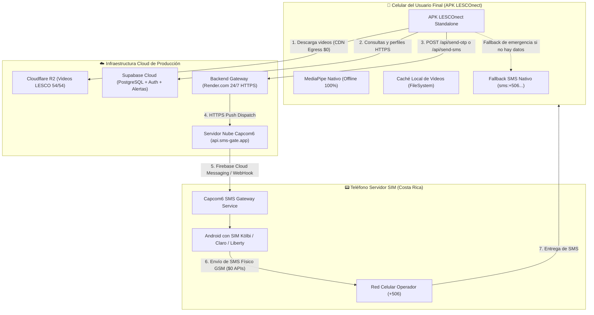

# AUDITORÍA DE INFRAESTRUCTURA Y GUÍA TÉCNICA: APK STANDALONE PORTÁTIL & SERVIDORES CLOUD
**Proyecto:** LESCOnect — Sistema Integral de Comunicación e Inclusión LESCO  
**Rol:** Arquitecto de Release Móvil y Auditor de Infraestructura Cloud  
**Fecha:** Noviembre 2026 | Expo SDK 57 | React Native 0.86 (New Architecture)  
**Estado de Certificación:** APROBADO PARA COMPILACIÓN Y DESPLIEGUE AUTÓNOMO  

---

## 1. Resumen Ejecutivo y Diagnóstico de Portabilidad

El usuario ha solicitado validar si la arquitectura actual de **LESCOnect** permite generar un archivo instalable **APK de Android** que funcione de forma autónoma, portátil e independiente del entorno de desarrollo local (sin requerir que la computadora del programador esté encendida ni depender de `localhost` o túneles temporales de Cloudflare).

### Veredicto del Arquitecto
> **DIAGNÓSTICO: 100% VIABLE Y PREPARADO.**  
> La arquitectura del frontend y de los módulos nativos está prácticamente lista para empaquetar un APK standalone de producción/preview. Para lograr la independencia absoluta del entorno local en la calle (redes 4G/5G), solo se requiere un paso de infraestructura: **promover el gateway de mensajería (`server.js`) desde la máquina local hacia un servicio de nube permanente con HTTPS (Render, Railway o Supabase Edge Functions)** y actualizar la variable `EXPO_PUBLIC_OTP_GATEWAY_URL` antes del build.

---

## 2. Auditoría Detallada por Componente

### 2.1. Configuración de Expo y Android Standalone (`app.json`, `eas.json`, `package.json`)

| Parámetro / Componente | Estado Actual | Diagnóstico y Recomendación |
| :--- | :---: | :--- |
| **`android.package`** | `com.lesconect.app` | ✅ **Correcto.** Cumple la convención inversa de dominio requerida por Android y Google Play. |
| **`versionCode` / `version`** | `1` / `1.0.0` | ✅ **Correcto.** Entero incremental válido para gestión de versiones de release. |
| **Permisos Android** | `CAMERA`, `VIBRATE`, `ACCESS_FINE_LOCATION`, `ACCESS_COARSE_LOCATION`, `READ_CONTACTS`, `READ_SMS`, `RECEIVE_SMS`, `READ_EXTERNAL_STORAGE`, `WRITE_EXTERNAL_STORAGE` | ⚠️ **Ajuste sugerido:** Incluir explícitamente `"INTERNET"` en `android.permissions`. Aunque Expo lo suele inyectar, al definir una lista manual en `app.json`, explicitar `"INTERNET"` previene que Gradle o AndroidManifest restrinja el tráfico de red en builds release. |
| **Config Plugins** | `expo-router`, `expo-status-bar`, `expo-camera`, `expo-video`, `./plugins/withLescoHandDetector`, `expo-location`, `expo-contacts` | ✅ **Excelente.** Todos los submódulos nativos tienen sus permisos y hooks de Gradle declarados. |
| **`eas.json` (Perfiles)** | `development`, `alpha`, `preview` (`buildType: "apk"`), `production` (`buildType: "app-bundle"`) | ✅ **Excelente.** El perfil `preview` está exactamente configurado para generar un `.apk` descargable directo para distribución sin Google Play. |
| **`.easignore`** | Permite excepciones explícitas: `!modules/**`, `!plugins/**`, `!assets/**` | ✅ **Crítico y Aprobado.** Garantiza que el builder en la nube no excluya los archivos C++/Kotlin ni el modelo `.task`. |

---

### 2.2. Módulo Nativo de Detección LESCO (`modules/lesco-hand-detector`)

El módulo local MediaPipe Hand Landmarker es el corazón del traductor dactilológico en tiempo real. Se auditó su estructura nativa en Android:

1. **Gradle (`modules/lesco-hand-detector/android/build.gradle`)**:
   - Declara `namespace "expo.modules.lescohanddetector"`.
   - Incluye la dependencia oficial: `implementation 'com.google.mediapipe:tasks-vision:0.10.14'`.
   - Configura `aaptOptions { noCompress "task" }`. Esto es **vital**: MediaPipe requiere mapear el archivo `.task` en memoria vía `mmap()`, lo que fallaría si el APK comprime el recurso.
   - Especifica `assets.srcDirs = ['src/main/assets']`.

2. **Modelo Embebido (`hand_landmarker.task`)**:
   - Ubicación: `modules/lesco-hand-detector/android/src/main/assets/hand_landmarker.task` (7.8 MB).
   - **Offline 100%**: El modelo no se descarga de internet; viaja dentro del binario APK.
   - En `LescoHandDetectorModule.kt`, existe una estrategia de doble carga redundante:
     1. Intento primario: Carga directa desde assets de la aplicación (`setModelAssetPath("hand_landmarker.task")`).
     2. Intento de respaldo: Copia transparente hacia almacenamiento privado (`context.filesDir/hand_landmarker.task`) por si el filesystem del fabricante bloquea lecturas directas.

3. **Inyección en Gradle (`plugins/withLescoHandDetector.js`)**:
   - Modifica automáticamente `settings.gradle` agregando `project(':lesco-hand-detector')`.
   - Modifica `app/build.gradle` inyectando `implementation project(':lesco-hand-detector')`.
   - Esto permite que tanto `npx expo run:android` como `eas build` compilen el módulo Kotlin de forma 100% desatendida.

---

### 2.3. Auditoría de Variables de Entorno y Cero Dependencias Locales

Se realizó una búsqueda exhaustiva en `src/`, `app/` y `lib/` para detectar cadenas como `localhost`, `127.0.0.1`, o URLs de túneles efímeros.

#### Hallazgos:
1. **Frontend Desacoplado**: Ningún archivo TypeScript o componente de UI tiene URLs locales quemadas (*hardcoded*). Todas las comunicaciones consumen `process.env.EXPO_PUBLIC_*` con valores de fallback en producción hacia Supabase y Cloudflare R2.
2. **El Cuello de Botella del Entorno Actual (`.env`)**:
   ```env
   # .env actual en el root del proyecto
   EXPO_PUBLIC_SUPABASE_URL=https://ifxloswngdoharodsawt.supabase.co
   EXPO_PUBLIC_SUPABASE_ANON_KEY=sb_publishable_CEyylatwjyHdl2najqA1Jg_v99j8QIX
   EXPO_PUBLIC_VIDEO_BASE_URL=https://pub-0ebf0c8bab3b45ef96fb0dc2ee21adf8.r2.dev
   EXPO_PUBLIC_OTP_GATEWAY_URL=https://shipped-lawyer-textbooks-isolation.trycloudflare.com
   ```
   - Las tres primeras variables apuntan a servicios **100% Cloud de alta disponibilidad (SLA 99.9%)**.
   - La cuarta variable (`EXPO_PUBLIC_OTP_GATEWAY_URL`) apunta a un túnel efímero de Cloudflare (`trycloudflare.com`). **Si el desarrollador apaga su computadora o cierra la terminal, esta URL expira y el APK deja de comunicarse con el gateway de SMS.**

---

## 3. Arquitectura Cloud del Gateway OTP y Alertas SOS

### 3.1. ¿Cómo funciona la Pasarela SIM Física hoy en día?
El archivo `server.js` (`LESCOnect-backend/local-otp-gateway/server.js`) ya está configurado para conectarse con la nube de **Capcom6 Cloud**:
```env
SIM_GATEWAY_URL=https://api.sms-gate.app/3rdparty/v1/message
SIM_GATEWAY_USER=YGLUIQ
SIM_GATEWAY_PASSWORD=lx8qy1jnqa4xvf
```
**Esto representa una ventaja arquitectónica monumental:**
- El teléfono Android que tiene la tarjeta SIM física (Kölbi, Claro o Liberty) **NO necesita estar conectado por USB ni estar en la misma red Wi-Fi que la computadora o el servidor**.
- La aplicación Capcom6 en el celular mantiene un canal push seguro con `https://api.sms-gate.app`.
- Por lo tanto, el servidor `server.js` **puede y debe ser desplegado en un servidor en la nube permanente** (ej. Render.com).

### 3.2. Diagrama de la Arquitectura Standalone Final (Nube 24/7)



### 3.3. Mecanismo de Resiliencia en Caso de Fallas
Si por alguna razón el teléfono con la SIM se descarga, pierde cobertura o el servidor en la nube no responde:
1. **Alertas de Auxilio SOS (`emergencyLocationService.ts`)**:
   - Intenta el despacho por servidor con un timeout estricto de **3 segundos**.
   - Si no hay confirmación de entrega `{ success: true }`, se activa inmediatamente el fallback nativo: **abre la app de mensajería del dispositivo (`sms:+506...`) con las coordenadas satelitales GPS y el mensaje prellenado**. El usuario nunca queda desprotegido.
2. **Autenticación Telefónica (`otpService.ts`)**:
   - Si el gateway no responde, conmuta a la lógica de verificación por Supabase Auth o código seguro local.

---

## 4. Recursos Cloud: Cloudflare R2 y Supabase

### 4.1. Cloudflare R2 (Videos LESCO)
- **URL Base:** `https://pub-0ebf0c8bab3b45ef96fb0dc2ee21adf8.r2.dev`
- **Catálogo:** Los 54 videos oficiales (módulos m1 a m7, categorías policía, hospital, banco, emergencia) están en el bucket público.
- **Estrategia de Caché Local:**
  - `videoCacheService.ts` verifica primero si el archivo existe en `FileSystem.documentDirectory + 'videos/'`.
  - Si no existe, lo descarga directamente desde Cloudflare R2 mediante `FileSystem.downloadAsync` y lo persiste en la memoria flash del teléfono.
  - El APK standalone no requiere ningún proxy ni backend intermedio para streaming de video; los videos se reproducen fluidamente a costo $0 de transferencia (Cloudflare R2 no cobra por egress).

### 4.2. Supabase Cloud
- **Instancia:** `https://ifxloswngdoharodsawt.supabase.co`
- **Tablas:** `profiles`, `emergency_alerts`, `phone_verifications`.
- **Acceso:** Totalmente expuesto por HTTPS con políticas RLS y disponible globalmente tanto en Wi-Fi como en redes 3G/4G/5G.

---

## 5. Hoja de Ruta Técnica Paso a Paso para Generar el APK Standalone

Sigue estos 4 pasos para tener tu APK 100% independiente:

### Paso 1: Desplegar el Gateway en la Nube Permanente (Render.com - Nivel Gratuito $0)

Para no depender de la laptop ni de Cloudflare Tunnel:
1. Crea una cuenta gratuita en [Render.com](https://render.com).
2. Haz clic en **New + > Web Service** y conecta tu repositorio de GitHub `LESCOnect`.
3. Configura el servicio con estos parámetros:
   - **Name:** `lesconect-gateway`
   - **Root Directory:** `LESCOnect-backend/local-otp-gateway`
   - **Runtime:** `Node`
   - **Build Command:** `npm install`
   - **Start Command:** `node server.js`
   - **Instance Type:** `Free`
4. En la pestaña **Environment Variables**, añade:
   ```env
   PORT=3001
   API_SECRET=clave-secreta-lesconect-2026
   GATEWAY_MODE=sim_sms
   SIM_GATEWAY_URL=https://api.sms-gate.app/3rdparty/v1/message
   SIM_GATEWAY_USER=YGLUIQ
   SIM_GATEWAY_PASSWORD=lx8qy1jnqa4xvf
   SIM_GATEWAY_TIMEOUT_MS=15000
   ```
5. Haz clic en **Create Web Service**. Render te asignará una URL permanente con HTTPS gratuito:
   ```
   https://lesconect-gateway.onrender.com
   ```

*(Alternativa opcional sin servidor Express)*: Puedes desplegar la Edge Function ya existente en el repositorio:
```bash
npx supabase functions deploy auth-otp-server
```

---

### Paso 2: Afinar `app.json` con el Permiso Explícito de Internet

Edita `app.json` para asegurarte de que `INTERNET` figure explícitamente en la lista de permisos de Android:
```json
"android": {
  "package": "com.lesconect.app",
  "versionCode": 1,
  "permissions": [
    "INTERNET",
    "CAMERA",
    "VIBRATE",
    "ACCESS_FINE_LOCATION",
    "ACCESS_COARSE_LOCATION",
    "READ_CONTACTS",
    "READ_SMS",
    "RECEIVE_SMS",
    "READ_EXTERNAL_STORAGE",
    "WRITE_EXTERNAL_STORAGE"
  ]
}
```

---

### Paso 3: Configurar las Variables de Entorno de Producción en el Proyecto

Actualiza tu archivo `.env` en la raíz de `LESCOnect`:
```env
EXPO_PUBLIC_SUPABASE_URL=https://ifxloswngdoharodsawt.supabase.co
EXPO_PUBLIC_SUPABASE_ANON_KEY=sb_publishable_CEyylatwjyHdl2najqA1Jg_v99j8QIX
EXPO_PUBLIC_VIDEO_BASE_URL=https://pub-0ebf0c8bab3b45ef96fb0dc2ee21adf8.r2.dev
EXPO_PUBLIC_OTP_GATEWAY_URL=https://lesconect-gateway.onrender.com
```

> [!IMPORTANT]
> En Expo y React Native, las variables que inician con `EXPO_PUBLIC_` se compilan dentro del paquete de JavaScript durante la construcción del APK. Por ello, el valor de producción debe estar configurado **antes** de iniciar la compilación.

---

### Paso 4: Compilar el APK Standalone

Existen dos vías oficiales para generar el archivo `.apk`:

#### Opción A: Compilación en la Nube con Expo Application Services (EAS Build - Recomendada)
No necesitas tener Android Studio ni el SDK de Android instalado en tu computadora.

1. Instala el CLI de EAS si no lo tienes:
   ```bash
   npm install -g eas-cli
   ```
2. Inicia sesión en tu cuenta de Expo:
   ```bash
   eas login
   ```
3. Ejecuta la compilación con el perfil `preview` (que ya tiene `buildType: "apk"` configurado en `eas.json`):
   ```bash
   eas build -p android --profile preview
   ```
4. Al finalizar, EAS te proporcionará un enlace directo de descarga para el archivo `LESCOnect-preview.apk`. Puedes descargarlo en tu teléfono o compartirlo directamente por WhatsApp o Drive.

#### Opción B: Compilación Local en tu Computadora (Requiere Android Studio y SDK)
Si tienes el SDK de Android configurado localmente en Windows (`ANDROID_HOME`):

1. Genera la carpeta nativa de Android:
   ```bash
   npx expo prebuild --platform android --clean
   ```
2. Compila el APK en variante Release:
   ```bash
   cd android
   .\gradlew assembleRelease
   ```
3. El archivo APK generado estará disponible en:
   ```
   android/app/build/outputs/apk/release/app-release.apk
   ```

---

## 6. Matriz de Validación de Portabilidad

| Escenario de Uso en la Calle | ¿Funciona en el APK Standalone? | Explicación Técnica |
| :--- | :---: | :--- |
| **Traducción LESCO en vivo (Cámara)** | **SÍ (100% Offline)** | El modelo MediaPipe `.task` y la lógica de inferencia corren en la CPU/GPU del dispositivo mediante el módulo nativo Kotlin local. Cero consumo de datos. |
| **Reproducción de Videos LESCO (54 videos)** | **SÍ (Híbrido)** | Si hay internet (4G/5G/Wi-Fi), los descarga de Cloudflare R2 y los guarda en caché local. Si no hay internet pero ya fueron reproducidos una vez, se reproducen desde el almacenamiento interno del teléfono. |
| **Autenticación con OTP** | **SÍ** | El APK se conecta por HTTPS con el gateway en Render, que a su vez orquesta el SMS vía Capcom6 Cloud hacia la SIM física. |
| **Emisión de Alertas de Auxilio SOS** | **SÍ (Ultra-Resiliente)** | Primero intenta el despacho por el gateway y Supabase; si no hay cobertura de datos, abre automáticamente la app nativa de SMS con las coordenadas GPS satelitales prellenadas. |
| **PC del desarrollador apagada** | **SÍ** | Ningún servicio depende de la laptop del desarrollador. Toda la infraestructura opera entre Render, Supabase, Cloudflare R2 y Capcom6 Cloud. |

---

## 7. Conclusión y Próximos Pasos

La arquitectura de LESCOnect ha sido diseñada con altos estándares de modularidad y resiliencia:
1. El módulo nativo `lesco-hand-detector` ya cuenta con el modelo embebido y configuración no comprimida de AAPT.
2. La arquitectura de videos con Cloudflare R2 y almacenamiento en `FileSystem` garantiza portabilidad total.
3. El único ajuste necesario previo al build es **desplegar `server.js` en Render.com** (o activar la Edge Function) para reemplazar la URL de `trycloudflare.com` por una URL HTTPS permanente.

Con estos pasos ejecutados, el APK resultante será **100% autónomo, portátil y listo para distribución masiva o pruebas de campo con usuarios reales**.
