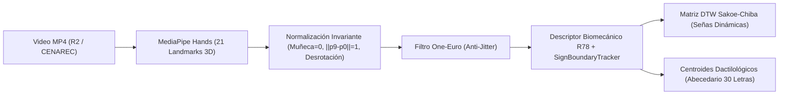

# Guía de Captura y Entrenamiento Continuo LESCO: Diccionario CENAREC y 54 Videos Oficiales LESCOnect

## 1. Introducción y Marco de Trabajo

El objetivo de esta guía es establecer el protocolo de ingeniería y lingüística aplicada para entrenar y calibrar el motor de reconocimiento y traducción de la Lengua de Señas Costarricense (LESCO) en LESCOnect.

El sistema se apoya en dos fuentes primarias de datos:
1. **Los 54 videos oficiales de LESCOnect** (Módulos 1 al 7), grabados con personas señantes nativas y alojados en Cloudflare R2 con resolución vertical ($720 \times 1280$) y audio/subtítulos alineados.
2. **El Diccionario Oficial LESCO del CENAREC** (Centro Nacional de Recursos para la Educación Inclusiva — MEP, Costa Rica: `https://lesco.cenarec.go.cr/index.php/diccionariolesco`).

---

## 2. Pipeline de Procesamiento de Video a Descriptores Biomecánicos ($\mathbb{R}^{78}$)

Cada video es procesado mediante el pipeline cinemático implementado en `lescoKeypointPipelineService.ts`:



### 2.1. Normalización Anatómica
- **Traslación**: La muñeca (Landmark 0) se fija como origen $(0,0,0)$.
- **Escala**: Se normalizan las distancias dividiendo entre la longitud euclidiana de la palma $\|\mathbf{p}_9 - \mathbf{p}_0\|$. Esto elimina la variabilidad por distancia a la cámara o tamaño biológico de la mano.
- **Alineación planar**: Se proyecta la rotación planar del eje muñeca–nudillo medio para que señas verticales sean comparables sin sesgo de inclinación del antebrazo.

### 2.2. Vector de Características $\mathbb{R}^{78}$
- 63 coordenadas $(x, y, z)$ de los 21 landmarks normalizados.
- 5 valores continuos $[0..1]$ de extensión articular por dedo.
- 5 ángulos de flexión compuesta PIP + DIP en grados normalizados.
- 5 distancias interdigitales y de pinza (pulgar-índice, pulgar-medio, apertura índice-medio).

---

## 3. Segmentación de Señas en Flujo Continuo con `SignBoundaryTracker`

Para separar el movimiento de reposición/transición del núcleo de la seña, se calcula la energía cinética de la mano:

$$E_t = \sum_{i \in \{0, 4, 8, 12, 16, 20\}} \left( \left(\frac{x_{i,t} - x_{i,t-1}}{\Delta t}\right)^2 + \left(\frac{y_{i,t} - y_{i,t-1}}{\Delta t}\right)^2 \right)$$

1. **Fase de Reposición (Transition)**: $E_t > \theta_{\text{mov}}$. La mano se desplaza hacia el plano de articulación.
2. **Fase de Retención (Hold)**: $E_t < \theta_{\text{hold}}$ durante $\ge 3$ fotogramas consecutivos. Es el punto de máxima definición de la postura dactilológica (A, B, C, etc.).
3. **Fase de Trazo Dinámico (Stroke)**: Movimiento coordinado característico (ej. trazo de Z, J, oscilación de HOLA o vaivén de Ñ). La trayectoria de la muñeca y el dedo guía se envía al motor DTW.

---

## 4. Estructura de Datos JSON para Extracción Automatizada

Cada video del catálogo CENAREC procesado genera un archivo de metadatos estandarizado:

```json
{
  "gloss": "HOSPITAL",
  "source": "cenarec-validado",
  "videoUrl": "https://lesco.cenarec.go.cr/media/hospital.mp4",
  "fps": 30,
  "frameCount": 48,
  "strokeRange": [12, 36],
  "dominantHandshape": "H",
  "location": "pecho",
  "palmOrientation": "frente",
  "movementType": "vertical_repetido",
  "keypointTrajectory": [
    { "frame": 12, "wrist": [0.0, 0.0, 0.0], "indexTip": [-0.08, -0.65, 0.12] },
    { "frame": 24, "wrist": [0.0, 0.05, 0.0], "indexTip": [-0.08, -0.72, 0.14] }
  ],
  "featureVector78": [0.0, 0.0, 0.0, -0.15, -0.25, 0.05],
  "dtwSignature": [
    { "x": 0.5, "y": 0.45 },
    { "x": 0.52, "y": 0.40 },
    { "x": 0.55, "y": 0.38 }
  ]
}
```

---

## 5. Inyección en el Motor de Coherencia Gramatical de LESCOnect

Para vincular las entradas del CENAREC con el vocabulario activo de la aplicación:

```typescript
import { registerCenarecVocabularyIntoGrammar } from './cenarecDictionaryService';

// Registra todas las glosas, sinónimos y categorías en memoria
const entriesLoaded = registerCenarecVocabularyIntoGrammar();
console.log(`Señas CENAREC cargadas en el motor: ${entriesLoaded}`);
```

El motor de coherencia gramatical (`lescoGrammarCoherenceService.ts`) utiliza estas entradas para:
1. Autocompletar en tiempo real mientras el usuario deletrea.
2. Corregir errores ópticos de cámara mediante Damerau-Levenshtein ponderado.
3. Desambiguar candidatos mediante el modelo de lenguaje de bigramas del corpus LESCO.
4. Sintetizar oraciones en español natural a partir del orden canónico `T-L-O-S-V-Neg`.

---

## 6. Protocolo Ético y Validación Lingüística con la Comunidad Sorda

1. **Derechos y Atribución**: Los materiales del CENAREC pertenecen al MEP (Ministerio de Educación Pública de Costa Rica). Su uso en LESCOnect debe mantener la atribución al Centro Nacional de Recursos para la Educación Inclusiva.
2. **Revisión por Pares Nativos**: Ninguna seña debe pasar a estado `cenarec-validado` sin la confirmación de una persona sorda hablante nativa de LESCO o un intérprete certificado por el MEP/CONAPDIS.
3. **Variación Dialectal Costarricense**: Respetar variantes de señas según zona geográfica (San José vs. Cartago vs. Alajuela/Heredia/Zona Sur) registrando las variantes como sinónimos querológicos en el diccionario.
