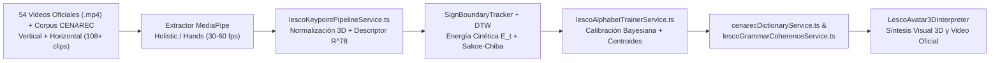
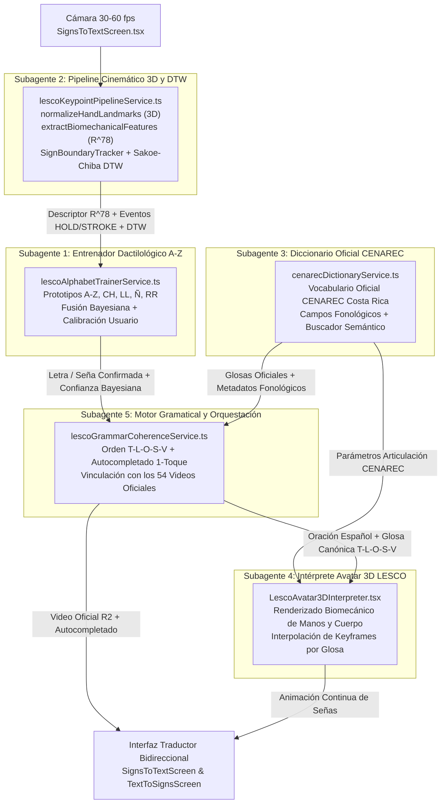
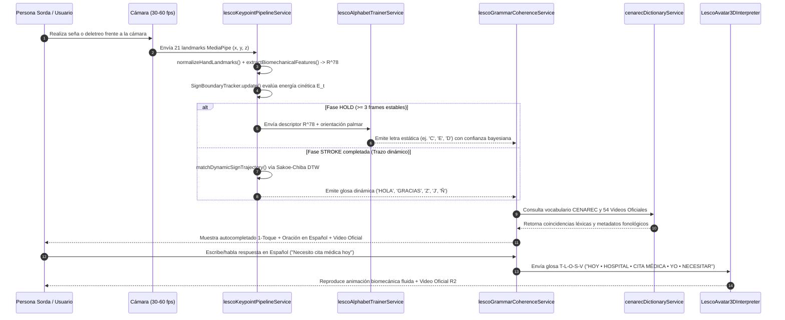

# Arquitectura de Entrenamiento con los 54 Videos Oficiales, Corpus CENAREC y Hoja de Ruta de los 5 Subagentes del Módulo de Traducción LESCOnect

**Proyecto:** LESCOnect — Costa Rica  
**Módulo:** Traductor Bidireccional LESCO (`src/modules/Traductor`)  
**Referencias Oficiales:** Guía de Diálogos y Frases para Grabación en LESCO (54 videos oficiales), Diccionario Audiovisual *CENAREC Costa Rica* y Manuales *Hands-On LESCO*.

---

## 1. ¿Es posible entrenar un modelo de reconocimiento continuo de manos directamente desde los 54 videos oficiales de LESCOnect y el catálogo CENAREC?

**Sí, es totalmente viable y constituye la ruta óptima de ingeniería para un modelo ligero, 100% offline y específico para el dominio institucional costarricense.**

En lugar de entrenar una red neuronal pesada sobre píxeles crudos (que requeriría miles de videos con distintos fondos, iluminaciones y vestimentas), el enfoque moderno de visión artificial para lengua de señas extrae primero el **esqueleto geométrico 3D libre de fondo** (*skeletal pose landmarks*) y el **descriptor biomecánico $\mathbb{R}^{78}$** de los **54 videos oficiales de LESCOnect** (disponibles en orientación `vertical` 9:16 y `horizontal` 16:9 en Cloudflare R2, sumando **108 archivos `.mp4`** de alta definición con intérprete experto) junto con los videos léxicos del **CENAREC**.

### 1.1. Extracción de Landmarks 3D y Descriptor Biomecánico ($\mathbb{R}^{78}$)
Cada archivo `.mp4` (`lesco/v1/m1..m7/*.mp4` y cápsulas del CENAREC) se procesa mediante el pipeline matemático implementado en [`src/modules/Traductor/services/lescoKeypointPipelineService.ts`](file:///D:/GitHub/LESCOnect/src/modules/Traductor/services/lescoKeypointPipelineService.ts):

1. **Normalización Geométrica Invariante 3D (`normalizeHandLandmarks`)**:
   - Traslada el origen a la muñeca $\vec{p}_0 = (0,0,0)$.
   - Escala isotrópicamente por la longitud anatómica de la palma $s = \|\vec{p}_9 - \vec{p}_0\|_2$.
   - Calcula el ángulo de rotación planar $\theta = \operatorname{atan2}(p_{9,x}, -p_{9,y})$ del eje muñeca–nudillo medio para producir coordenadas normalizadas $(21 \times 3 = 63\text{ valores})$ invariantes a distancia de la cámara e inclinación planar.
2. **Descriptor Biomecánico por Frame (`extractBiomechanicalFeatures` $\in \mathbb{R}^{78}$)**:
   - **63 valores:** Coordenadas 3D normalizadas $(x_i, y_i, z_i)$ para $i \in \{0..20\}$.
   - **5 valores:** Estado de extensión continuo $[0..1]$ de los 5 dedos (`thumb`, `index`, `middle`, `ring`, `pinky`).
   - **5 valores:** Ángulos de flexión articular compuestos (PIP + DIP normalizados en $[0..1]$, más exposición directa en grados $[0^\circ..180^\circ]$).
   - **5 valores:** Distancias de pinza e interdigitales normalizadas (`thumbToIndex`, `thumbToMiddle`, `thumbToRing`, `thumbToPinky`, `indexToMiddleSpread`).
   - **Metadatos fonológicos LESCO:** Orientación estimada de la palma (`'frente' | 'dorso' | 'lateral' | 'abajo' | 'arriba'`) y zona espacial corporal (`'sien_frente' | 'menton_boca' | 'pecho' | 'espacio_neutro'`).

### 1.2. Detección de Fronteras en Flujo Continuo (`SignBoundaryTracker`) y DTW
Para aislar cada seña sin obligar al usuario a bajar la mano entre letras:
1. **Energía Cinética Instantánea ($E_t = \|\vec{v}_t\|^2$):**
   $$E_t = \frac{1}{6} \sum_{k \in \{0,4,8,12,16,20\}} \|\vec{p}_{k,t} - \vec{p}_{k,t-1}\|_2^2$$
2. **Máquina de Estados Cinemática (`IDLE` $\to$ `TRANSITION` $\to$ `HOLD` / `STROKE`):**
   - **Reposición / Transición (`TRANSITION`):** $E_t > \theta_{\text{trans}}$, se descartan falsos positivos mientras la mano viaja de una configuración a otra.
   - **Retención Estática (`HOLD`):** $E_t < \theta_{\text{hold}}$ durante $\ge 3$ frames consecutivos, emitiendo `isStaticSignReady = true`.
   - **Trazo Dinámico (`STROKE`):** Energía controlada $\theta_{\text{hold}} \le E_t \le \theta_{\text{trans}}$ que acumula la trayectoria 2D de la mano y dispara `isDynamicStrokeCompleted = true` al concluir el gesto.
3. **Alineación Temporal Dinámica (`computeTrajectoryDTW` y `matchDynamicSignTrajectory`):**
   - Compara la trayectoria capturada (re-muestreada a 16 puntos equidistantes en $[-1, 1]^2$) mediante **DTW con banda de restricción de Sakoe-Chiba** contra las plantillas prototipo de señas dinámicas LESCO: `Z` (zigzag), `J` (gancho curvo), `Ñ` (onda horizontal corta), `LL` y `RR` (deslizamiento lateral), `HOLA` (arco oscilante en sien), `GRACIAS` (avance desde mentón), `POR FAVOR` (círculo en pecho), `SÍ` (cabeceo vertical) y `NO` (pinza rápida).

---

## 2. Arquitectura y Hoja de Ruta de los 5 Subagentes del Módulo de Traducción

Para desarrollar, entrenar, mantener y ejecutar el Módulo de Traducción en paralelo sin colisiones de archivos, el ecosistema se estructura en **5 Subagentes Especializados** conectados mediante contratos TypeScript estrictos:

---

### Detalle de los 5 Subagentes y sus Módulos

#### Subagente 1: Entrenador Inteligente del Abecedario LESCO (`lescoAlphabetTrainerService.ts`)
- **Misión:** Dominar las 30 señas del abecedario dactilológico costarricense (`A–Z`, `CH`, `LL`, `Ñ`, `RR`), resolviendo ambigüedades clásicas de cámara frontal (`A/S/E/O`, `M/N`, `U/V/R/K`, `D/G/P/Q`, `I/J/Y`).
- **Integración:** Consume el descriptor $\mathbb{R}^{78}$ de `lescoKeypointPipelineService.ts`, calcula similitud coseno ponderada por articulación, aplica calibración adaptativa por usuario (*Few-Shot Personal Calibration* persistida localmente) y realiza fusión bayesiana con el historial de letras para suavizar predicciones.

#### Subagente 2: Pipeline Cinemático 3D, Fronteras y DTW (`lescoKeypointPipelineService.ts`)
- **Misión:** Proveer la capa matemática pura de extracción de características 3D invariantes (`normalizeHandLandmarks`), el vector biomecánico de 78 dimensiones (`extractBiomechanicalFeatures`), el detector de fronteras por energía cinética (`SignBoundaryTracker`) y el comparador de trayectorias dinámicas (`computeTrajectoryDTW` y `matchDynamicSignTrajectory`).
- **Integración:** Alimenta tanto al clasificador en tiempo real de `SignsToTextScreen` como al `lescoAlphabetTrainerService` y al pipeline de extracción offline de los 54 videos oficiales.

#### Subagente 3: Conector del Diccionario Oficial CENAREC (`cenarecDictionaryService.ts`)
- **Misión:** Estructurar el léxico oficial del **Centro Nacional de Recursos para la Educación Inclusiva (CENAREC — MEP Costa Rica)** categorizado por dominios prioritarios (Salud/CCSS, Bancos, Emergencias 9-1-1, Educación, Trámites Civiles, Familia, Tiempo y Cortesía).
- **Integración:** Cada entrada incluye su glosa LESCO, configuración manual (*handshape*), ubicación corporal (`sien_frente`, `menton_boca`, `pecho`, `espacio_neutro`), tipo de movimiento y enlace al recurso audiovisual, nutriendo tanto a `lescoGrammarCoherenceService` como a `LescoAvatar3DInterpreter`.

#### Subagente 4: Intérprete Visual Avatar 3D / Esqueleto Animado (`LescoAvatar3DInterpreter.tsx`)
- **Misión:** Sintetizar visualmente cualquier glosa LESCO o deletreo dactilológico cuando el usuario escribe o dicta una frase en español (incluso para palabras fuera de los 54 videos grabados), renderizando un intérprete esquemático/biomecánico con manos, torso, expresiones faciales no manuales (cejas en interrogación, negación cefálica) y trayectoria cinemática interpolada.
- **Integración:** Recibe la secuencia de tokens en orden `TIEMPO → LUGAR → OBJETO → SUJETO → VERBO` generada por `lescoGrammarCoherenceService.ts` y los parámetros fonológicos de `cenarecDictionaryService.ts`.

#### Subagente 5: Motor de Coherencia Lingüística LESCO $\leftrightarrow$ Español (`lescoGrammarCoherenceService.ts`)
- **Misión:** Transformar secuencias de letras deletreadas y glosas telegráficas hacia oraciones coherentes en español natural y viceversa, manteniendo el catálogo maestro de los **54 videos oficiales de LESCOnect**.
- **Integración:** Conecta el deletreo vivo de `SignsToTextScreen` con sugerencias de autocompletado en 1 toque (`CED...` $\to$ `CÉDULA`, `HOSP...` $\to$ `HOSPITAL`), predicción gramatical de siguiente seña y emparejamiento directo con los videos `.mp4` alojados en Cloudflare R2.

---

## 3. Flujo de Interacción Secuencial en Tiempo Real (Señas $\leftrightarrow$ Español)

---

## 4. Guía de Entrenamiento Continuo con Videos del CENAREC y los 54 Videos Oficiales de LESCOnect

### Paso 1: Ingesta de Videos y Extracción de Tensores $\mathbb{R}^{78}$
1. Colocar los 54 videos oficiales (`lesco/v1/m1..m7/*.mp4` en formato vertical y horizontal) y los clips descargados del diccionario CENAREC en el directorio de corpus local.
2. Ejecutar el extractor de *landmarks* a 30 fps y pasar cada frame por `extractBiomechanicalFeatures(landmarks)` de [`lescoKeypointPipelineService.ts`](file:///D:/GitHub/LESCOnect/src/modules/Traductor/services/lescoKeypointPipelineService.ts) para obtener matrices de dimensión $(T \times 78)$ por mano.

### Paso 2: Segmentación Automática de Glosas con `SignBoundaryTracker`
1. Alimentar la secuencia de frames de cada diálogo en una instancia de `SignBoundaryTracker({ holdEnergyThreshold: 0.0012, minHoldFrames: 3 })`.
2. Cada transición `STROKE -> HOLD` delimita automáticamente los segmentos temporales $[t_{\text{inicio}}, t_{\text{fin}}]$ que se alinean monotónicamente con los tokens de la glosa oficial (`HOLA • YO PERSONA SORDA • TRÁMITE REALIZAR VENIR`).

### Paso 3: Actualización de Prototipos DTW y Centroides Dactilológicos
1. Para las señas con movimiento (`Z`, `J`, `Ñ`, `LL`, `RR`, `HOLA`, `GRACIAS`, `POR FAVOR`, `SÍ`, `NO`), promediar las trayectorias normalizadas con `normalizeTrajectory2D(points, 16)` (DTW Barycenter Averaging) y actualizar `DYNAMIC_SIGN_PROTOTYPES` en `lescoKeypointPipelineService.ts`.
2. Para las 30 letras del abecedario dactilológico y señas estáticas del CENAREC, recalcular los centroides biomecánicos en `lescoAlphabetTrainerService.ts` y registrar las nuevas entradas léxicas en `cenarecDictionaryService.ts`.

### Paso 4: Calibración Personalizada en Dispositivo (*On-Device Few-Shot Learning*)
1. Desde la interfaz de entrenamiento de `SignsToTextScreen`, cualquier usuario puede grabar 3 a 5 muestras rápidas de su propia mano realizando una letra o seña.
2. `lescoAlphabetTrainerService.ts` combina el centroide canónico (entrenado con los 54 videos oficiales y CENAREC) con el centroide personal del usuario en `AsyncStorage`, adaptándose instantáneamente a la anatomía y cámara de cada persona sin requerir reentrenamiento en servidor.

---

## 5. Matriz de Aislamiento de Archivos por Subagente

| Subagente | Archivo Principal (Responsabilidad Exclusiva) | Integración en el Pipeline |
| :--- | :--- | :--- |
| **Subagente 1** | [`src/modules/Traductor/services/lescoAlphabetTrainerService.ts`](file:///D:/GitHub/LESCOnect/src/modules/Traductor/services/lescoAlphabetTrainerService.ts) | Clasificador dactilológico `A-Z`, calibración de usuario y fusión bayesiana. |
| **Subagente 2** | [`src/modules/Traductor/services/lescoKeypointPipelineService.ts`](file:///D:/GitHub/LESCOnect/src/modules/Traductor/services/lescoKeypointPipelineService.ts) [`LESCOnect-backend/TRADUCTOR_SUBAGENTS_ARCHITECTURE.md`](file:///D:/GitHub/LESCOnect/LESCOnect-backend/TRADUCTOR_SUBAGENTS_ARCHITECTURE.md) | Normalización 3D, descriptor biomecánico $\mathbb{R}^{78}$, `SignBoundaryTracker` y DTW Sakoe-Chiba. |
| **Subagente 3** | [`src/modules/Traductor/services/cenarecDictionaryService.ts`](file:///D:/GitHub/LESCOnect/src/modules/Traductor/services/cenarecDictionaryService.ts) | Diccionario estructurado del CENAREC Costa Rica con metadatos fonológicos. |
| **Subagente 4** | [`src/modules/Traductor/components/LescoAvatar3DInterpreter.tsx`](file:///D:/GitHub/LESCOnect/src/modules/Traductor/components/LescoAvatar3DInterpreter.tsx) | Intérprete visual animado por glosas y deletreo para `TextToSignsScreen`. |
| **Subagente 5** | [`src/modules/Traductor/services/lescoGrammarCoherenceService.ts`](file:///D:/GitHub/LESCOnect/src/modules/Traductor/services/lescoGrammarCoherenceService.ts) | Coherencia gramatical `T-L-O-S-V`, autocompletado y enlace a los 54 videos oficiales. |
